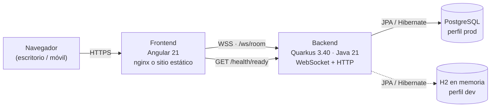

# True Fan Dice Roller 🎲🃏

Aplicación tipo chat para lanzar dados d6 (con explosión y modificador) y sacar cartas de una baraja española virtual, en tiempo real con amigos.

**Stack**: Angular 21 (frontend) + Quarkus 3.40 LTS / Java 21 (backend) + WebSockets + JPA (H2 en desarrollo, PostgreSQL en producción).

---

## Índice

- [Arquitectura](#arquitectura)
- [Funcionalidades](#funcionalidades)
- [Desarrollo local](#desarrollo-local)
- [Tests](#tests)
- [Despliegue con Docker](#despliegue-con-docker)
- [Despliegue estático en Render](#despliegue-estático-en-render)
- [Despliegue en GitHub Pages](#despliegue-en-github-pages)
- [Configuración de backend URL](#configuración-de-backend-url)
- [Estructura del proyecto](#estructura-del-proyecto)

---

## Arquitectura

La aplicación sigue una arquitectura de tres capas: un frontend estático, un backend que concentra la lógica de juego y la comunicación en tiempo real, y PostgreSQL como almacenamiento.



- **Frontend**: SPA de Angular servida por nginx (Docker) o por un CDN estático (Render, GitHub Pages). No guarda estado de juego; solo mantiene la sesión y el tema.
- **Backend**: Quarkus expone el WebSocket `/ws/room` para el chat y las acciones de juego, y los endpoints de salud `/health/live` y `/health/ready`. Es la única capa que habla con la base de datos.
- **Base de datos**: PostgreSQL en producción. En desarrollo el perfil `dev` usa H2 en memoria, por lo que no hace falta levantar nada externo.
- **Comunicación**: el navegador descarga la SPA desde el frontend, pero el WebSocket y el health check van directamente al backend (por eso `BACKEND_WS_URL` debe apuntar al backend, no al frontend).

---

## Funcionalidades

- **Salas en tiempo real** con código de 7 caracteres, nickname y sesión firmada con JWT (reconexión automática).
- **Dados d6 explosivos**: cada 6 genera otra tirada; soporte de modificador y de una reserva compartida (`pool`).
- **Baraja española** de 50 naipes (incluidos los dos comodines), con contador de mazo, barajado y activación/desactivación por el admin.
- **Chat** con historial reciente y entradas de sistema (altas, bajas, cambios de admin, tiradas y cartas).
- **Comandos de chat**: `/carta`, `/roll` y `/Nd6±M` (por ejemplo `/3d6+3`). Lo que no encaja con un comando se envía como mensaje normal.
- **Panel de admin**: activar/desactivar cartas, expulsar jugadores y usar la reserva.
- **Listado de jugadores** al pulsar el contador del header.
- **Indicador de estado del backend** con comprobación periódica de `/health/ready`.
- **14 temas visuales** (clásico, Alejo, ocean, tardeo, bosque, pergamino, sakura, neón, playeo, Drácula, Halloween, Matrix, Batman y espacial) que se guardan en el navegador.
- …y algún secreto más que no vamos a desvelar aquí.

---

## Desarrollo local

### Requisitos

| Herramienta | Versión |
|-------------|---------|
| JDK | 21 |
| Apache Maven | 3.9+ |
| Node.js | 22.x (Angular 21 admite `^20.19`, `^22.12` o `>=24`) |
| Angular CLI | 21.x (`npm install -g @angular/cli@21`) |

### Backend (Quarkus)

```bash
cd backend
$env:JAVA_HOME="C:\programas\jdk-21.0.10"   # Windows
export JAVA_HOME=/path/to/jdk-21              # Linux/macOS

mvn quarkus:dev
```

El backend arranca en `http://localhost:8080` con H2 en memoria y recarga en caliente.

- Perfil `dev` (por defecto): H2 en memoria, esquema `drop-and-create`.
- Perfil `prod`: PostgreSQL. Se puede probar en local con `mvn quarkus:dev -Dquarkus.profile=prod` y las variables `DB_*`.

Endpoints útiles:

| Endpoint | Uso |
|----------|-----|
| `http://localhost:8080/ws/room` | WebSocket de la sala |
| `http://localhost:8080/health/live` | Liveness |
| `http://localhost:8080/health/ready` | Readiness (verifica la conexión a base de datos) |

### Frontend (Angular)

```bash
cd frontend
npm install
npx ng serve
```

El frontend arranca en `http://localhost:4200` y conecta automáticamente al backend en `localhost:8080` (ver `proxy.conf.json` y la auto-detección de `env.js`).

---

## Tests

```bash
# Frontend (Vitest)
cd frontend
npx ng test --watch=false

# Backend (JUnit + Quarkus Test)
cd backend
mvn test
```

---

## Despliegue con Docker

### docker-compose (recomendado)

#### Desarrollo (H2 en memoria)

```bash
docker compose -f docker-compose.desa.yml up -d
```

Abrir `http://localhost:4200`. El backend usa H2 en memoria, no necesita base de datos externa.

#### Producción (PostgreSQL externo)

```bash
export DB_URL=jdbc:postgresql://mi-postgres:5432/diceroller
export DB_USER=postgres
export DB_PASSWORD=secreta
export JWT_SECRET=clave-hmac-de-al-menos-32-caracteres!!
export BACKEND_WS_URL=wss://api.midominio.com/ws/room

docker compose -f docker-compose.prod.yml up -d
```

PostgreSQL **no está incluido** en el compose — debes tenerlo corriendo aparte.

---

### Construcción manual de imágenes

#### Frontend

```bash
cd frontend
docker build -t dice-roller-frontend .
```

```bash
docker run -d \
  -p 80:80 \
  -e BACKEND_WS_URL="wss://tu-servidor.com/ws/room" \
  -e BACKEND_HTTP_URL="https://tu-servidor.com" \
  --name dice-front \
  dice-roller-frontend
```

La imagen es multi-stage (`node:22-alpine` → `nginx:1.27-alpine`) y la URL del backend se inyecta en runtime mediante `envsubst`; no hace falta reconstruir al cambiar de entorno.

#### Backend — Imagen JVM estándar

```bash
cd backend
docker build -t dice-roller-backend:jvm .
```

El Dockerfile multi-stage compila con Maven y deja una imagen final con JDK 21.

**Ejecutar con PostgreSQL externo:**

```bash
docker run -d \
  -p 8080:8080 \
  -e QUARKUS_PROFILE=prod \
  -e DB_URL=jdbc:postgresql://mi-postgres:5432/diceroller \
  -e DB_USER=postgres \
  -e DB_PASSWORD=secreta \
  -e JWT_SECRET="clave-hmac-de-al-menos-32-caracteres!!" \
  --name dice-back \
  dice-roller-backend:jvm
```

#### Backend — Imagen nativa

Requiere Docker para compilar en contenedor. Quarkus 3.36+ necesita GraalVM/Mandrel **25** como mínimo para el build nativo, aunque el bytecode siga siendo Java 21. El perfil `native` ya apunta al builder image `quay.io/quarkus/ubi9-quarkus-mandrel-builder-image:jdk-25`.

```bash
cd backend
mvn package -Pnative -Dquarkus.native.container-build=true -DskipTests
docker build -f src/main/docker/Dockerfile.native -t dice-roller-backend:native .
```

```bash
docker run -d \
  -p 8080:8080 \
  -e QUARKUS_PROFILE=prod \
  -e DB_URL=jdbc:postgresql://postgres:5432/diceroller \
  -e DB_USER=postgres \
  -e DB_PASSWORD=postgres \
  --name dice-back-native \
  dice-roller-backend:native
```

La imagen nativa arranca en **milisegundos** y consume mucha menos RAM.

### Docker Compose completo (ejemplo)

`docker-compose.yml` (puedes crearlo en la raíz):

```yaml
services:
  postgres:
    image: postgres:16-alpine
    environment:
      POSTGRES_DB: diceroller
      POSTGRES_USER: postgres
      POSTGRES_PASSWORD: postgres
    volumes:
      - pgdata:/var/lib/postgresql/data

  backend:
    image: dice-roller-backend:native
    ports:
      - "8080:8080"
    environment:
      QUARKUS_PROFILE: prod
      DB_URL: jdbc:postgresql://postgres:5432/diceroller
      DB_USER: postgres
      DB_PASSWORD: postgres
    depends_on:
      - postgres

  frontend:
    image: dice-roller-frontend
    ports:
      - "80:80"
    environment:
      BACKEND_WS_URL: ws://localhost:8080/ws/room
      BACKEND_HTTP_URL: http://localhost:8080
    depends_on:
      - backend

volumes:
  pgdata:
```

---

## Despliegue estático en Render

El frontend no necesita contenedor: se puede publicar como **Static Site**.

1. **New + → Static Site** y conecta el repositorio.
2. Configuración:

   | Campo | Valor |
   |-------|-------|
   | Root Directory | `frontend` |
   | Build Command | `npm ci && npm run build:static` |
   | Publish Directory | `dist/frontend/browser` |
   | Node version | `22.22.0` (variable `NODE_VERSION`) |

3. Variables de entorno:

   | Variable | Ejemplo |
   |----------|---------|
   | `BACKEND_WS_URL` | `wss://tu-backend.onrender.com/ws/room` |
   | `BACKEND_HTTP_URL` | `https://tu-backend.onrender.com` |

4. **Redirects/Rewrites** → regla `/*` → `/index.html`, acción **Rewrite** (necesario para las rutas de Angular como `/room/CODIGO`).

`npm run build:static` ejecuta `ng build --configuration production` y después `scripts/generate-env.mjs`, que genera `assets/env.js` a partir de las variables de entorno del build.

---

## Despliegue en GitHub Pages

### 1. Configurar secrets del repositorio

En **Settings > Secrets and variables > Actions**, añade:

| Secret | Ejemplo | Descripción |
|--------|---------|-------------|
| `BACKEND_WS_URL` | `wss://api.midominio.com/ws/room` | URL WebSocket del backend |
| `BACKEND_HTTP_URL` | `https://api.midominio.com` | URL HTTP del backend |

Si no pones secrets, el frontend usará auto-detección relativa (solo útil si sirves backend y frontend desde el mismo dominio).

### 2. Habilitar GitHub Pages

En **Settings > Pages**:
- **Source**: GitHub Actions

### 3. Desplegar

El workflow se ejecuta automáticamente al hacer push a `main` (cuando se toca `frontend/`).

También puedes ejecutarlo manualmente:
1. Ve a **Actions > Deploy Frontend to GitHub Pages**
2. Pulsa **Run workflow**
3. Opcional: introduce la URL del backend manualmente

### 4. Configurar base-href

Si tu repositorio se llama `usuario/repo`, la URL será `https://usuario.github.io/repo/`.
El workflow ya ajusta `--base-href` automáticamente.

Si tu repo es `usuario.github.io` (site root), cambia en el workflow:

```yaml
--base-href /
```

---

## Configuración de backend URL

La URL del backend se define en **runtime** (Docker) o en **build time** (hosting estático), sin meterla en el bundle de Angular:

### Mecanismo

1. `src/index.html` carga `assets/env.js` antes del bundle.
2. `src/assets/env.template.js` contiene los placeholders `${BACKEND_WS_URL}` y `${BACKEND_HTTP_URL}`.
3. Según el entorno se genera `assets/env.js`:
   - **Docker**: `docker-entrypoint.sh` ejecuta `envsubst` al arrancar el contenedor.
   - **Render / builds estáticos**: `scripts/generate-env.mjs` lo genera después del build (`npm run build:static`).
   - **GitHub Pages**: el workflow lo genera desde los secrets.
4. El frontend lee `window.__env.backendWsUrl` y `window.__env.backendHttpUrl`.

### Variables de entorno

| Variable | Propósito | Ejemplo |
|----------|-----------|---------|
| `BACKEND_WS_URL` | URL completa del WebSocket | `wss://api.example.com/ws/room` |
| `BACKEND_HTTP_URL` | URL HTTP del backend (health check) | `https://api.example.com` |
| `JWT_SECRET` | Clave HMAC-SHA256 (mínimo 32 caracteres) | `clave-hmac-de-al-menos-32-caracteres!!` |
| `DB_URL` | JDBC de PostgreSQL (perfil `prod`) | `jdbc:postgresql://host:5432/diceroller` |
| `DB_USER` / `DB_PASSWORD` | Credenciales de PostgreSQL | `postgres` / `secreta` |
| `CORS_ORIGINS` | Orígenes permitidos (por defecto `*`) | `https://app.midominio.com` |

Si `BACKEND_WS_URL` está vacío, el frontend intenta auto-detectarlo:
- **Dev** (`:4200`): conecta a `localhost:8080`.
- **Producción**: conecta al mismo host desde donde se sirve (solo válido con proxy inverso).

---

## Estructura del proyecto

```
.
├── backend/                              # Quarkus 3.40 LTS — Java 21
│   ├── src/main/java/.../entity/         # JPA: Room, RoomUser, ChatEntry
│   ├── src/main/java/.../service/        # GameService, RoomService, JwtService, RoomCleanupService
│   ├── src/main/java/.../websocket/      # RoomWebSocket (/ws/room)
│   ├── src/main/java/.../                # MyLivenessCheck, MyReadinessCheck
│   └── src/main/docker/                  # Dockerfile.jvm, .native, .legacy-jar
├── frontend/                             # Angular 21
│   ├── src/app/components/lobby/         # Pantalla de entrada
│   ├── src/app/components/room/          # Sala, comandos de chat y listado de jugadores
│   ├── src/app/components/room/easter-egg/ # Efectos secretos
│   ├── src/app/components/backend-status-indicator/
│   ├── src/app/services/                 # WebSocket y health check
│   ├── src/assets/env.template.js        # Plantilla de entorno runtime
│   ├── scripts/generate-env.mjs          # Genera env.js en builds estáticos
│   ├── Dockerfile                        # Multi-stage (build + nginx)
│   ├── nginx.conf                        # Configuración nginx SPA
│   └── docker-entrypoint.sh              # Inyección de env vars
├── open-design/                          # Diseño visual y especificación
├── docker-compose.desa.yml               # Compose de desarrollo (H2)
├── docker-compose.prod.yml               # Compose de producción (PostgreSQL)
└── .github/workflows/deploy-pages.yml    # Despliegue en GitHub Pages
```

---

## Especificación completa

Ver [`open-design/SPECIFICATION.md`](open-design/SPECIFICATION.md) para la especificación detallada del proyecto, incluyendo:

- Grupos de requisitos funcionales (FR1–FR11)
- Protocolo WebSocket completo
- Modelo de datos JPA
- Flujos alternativos
- Criterios de aceptación
