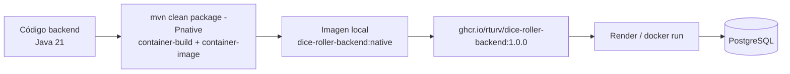

# Backend: imagen nativa en GHCR

El backend se publica como una **imagen Docker con el ejecutable nativo de Quarkus** (sin JVM) y se guarda en GitHub Container Registry:

```text
ghcr.io/rturv/dice-roller-backend:1.0.0
```

La imagen se compila y publica **manualmente desde una máquina local**, sin pipelines de CI/CD. Este documento describe el proceso completo para reproducirla, actualizarla y desplegarla.

---

## Índice

- [Cómo se construye](#cómo-se-construye)
- [Requisitos](#requisitos)
- [1. Build nativo e imagen](#1-build-nativo-e-imagen)
- [2. Publicar en GHCR](#2-publicar-en-ghcr)
- [3. Ejecutar la imagen](#3-ejecutar-la-imagen)
- [4. Desplegar en Render](#4-desplegar-en-render)
- [Verificación](#verificación)
- [Actualizar la versión](#actualizar-la-versión)
- [Problemas comunes](#problemas-comunes)
- [Por qué nativo](#por-qué-nativo)

---

## Cómo se construye



- El perfil Maven `native` activa `quarkus.native.enabled=true`, desactiva el JAR y apunta al builder image Mandrel 25.
- `-Dquarkus.native.container-build=true` compila el binario Linux **dentro de un contenedor**, así que no hace falta instalar GraalVM localmente.
- `-Dquarkus.container-image.build=true` hace que la extensión `quarkus-container-image-docker` construya la imagen Docker usando `src/main/docker/Dockerfile.native` (configurado en el perfil `native` del `pom.xml`).
- `-Dquarkus.container-image.image=dice-roller-backend:native` fija el nombre y la etiqueta de la imagen local.
- **No hay un `docker build` separado**: el build nativo y la imagen salen del mismo comando.
- El resultado intermedio es un binario Linux en `target/*-runner`; `Dockerfile.native` lo empaqueta sobre `ubi9/ubi-minimal` y lo ejecuta como usuario `1001`.
- El bytecode de la aplicación sigue siendo **Java 21** (`maven.compiler.release=21`); Mandrel 25 es solo el compilador nativo.

---

## Requisitos

| Requisito | Detalle |
|---|---|
| Docker | Docker Desktop o Engine en marcha (build nativo en contenedor + construcción de la imagen) |
| JDK 21 | Para compilar el bytecode (`C:\programas\jdk-21.0.10` en local) |
| Maven 3.9+ | O el wrapper `mvnw` del repo |
| Memoria | 4 GB libres recomendados para el builder nativo |
| Cuenta GHCR | Usuario de GitHub con permiso `write:packages` |

Comprueba que Docker responde:

```bash
docker version
```

---

## 1. Build nativo e imagen

El build real se hace en **un solo comando**: compila el nativo y construye la imagen Docker. Desde `backend/`:

```powershell
# Windows
$env:JAVA_HOME="C:\programas\jdk-21.0.10"
mvn clean package -Pnative `
  "-Dquarkus.native.container-build=true" `
  -DskipTests `
  "-Dquarkus.container-image.build=true" `
  "-Dquarkus.container-image.image=dice-roller-backend:native"
```

```bash
# Linux / macOS
export JAVA_HOME=/path/to/jdk-21
mvn clean package -Pnative \
  -Dquarkus.native.container-build=true \
  -DskipTests \
  -Dquarkus.container-image.build=true \
  -Dquarkus.container-image.image=dice-roller-backend:native
```

También se puede escribir en una sola línea:

```bash
mvn clean package -Pnative "-Dquarkus.native.container-build=true" -DskipTests "-Dquarkus.container-image.build=true" "-Dquarkus.container-image.image=dice-roller-backend:native"
```

Qué hace cada flag:

| Flag | Efecto |
|---|---|
| `clean package` | Limpia `target/` y empaqueta |
| `-Pnative` | Activa el perfil nativo del `pom.xml` (JAR desactivado, builder Mandrel 25, Dockerfile nativo) |
| `-Dquarkus.native.container-build=true` | Compila el binario Linux dentro de un contenedor (obligatorio en Windows) |
| `-DskipTests` | Omite los tests para acelerar |
| `-Dquarkus.container-image.build=true` | Construye la imagen Docker con la extensión `container-image` |
| `-Dquarkus.container-image.image=dice-roller-backend:native` | Nombre y etiqueta de la imagen local |

Al terminar deben existir:

```text
backend/target/dice-roller-ws-1.0.0-SNAPSHOT-runner   # binario nativo
dice-roller-backend:native                            # imagen Docker local
```

Compruébalo:

```bash
docker images dice-roller-backend
```

Notas:

- **`-Dquarkus.native.container-build=true` es obligatorio en Windows**: sin él, Quarkus intentaría usar un GraalVM local y generaría un `.exe` de Windows, inservible para una imagen Linux.
- El primer build descarga el builder image y tarda varios minutos.
- `Dockerfile.native` copia `target/*-runner` como `/work/application`, expone `8080` y arranca con `./application -Dquarkus.http.host=0.0.0.0`.

### Alternativa manual (sin `container-image`)

Si prefieres separar los pasos:

```bash
mvn clean package -Pnative -Dquarkus.native.container-build=true -DskipTests
docker build -f src/main/docker/Dockerfile.native -t dice-roller-backend:native .
```

Y si construyes desde una máquina ARM (Apple Silicon) para desplegar en `amd64`:

```bash
docker build --platform linux/amd64 -f src/main/docker/Dockerfile.native -t dice-roller-backend:native .
```

---

## 2. Publicar en GHCR

1. Crea un **Personal Access Token** de GitHub (classic) con permisos `read:packages` y `write:packages`. No lo guardes en el repositorio.

2. Autentícate:

   ```powershell
   $env:GITHUB_TOKEN | docker login ghcr.io -u rturv --password-stdin
   ```

   ```bash
   echo "$GITHUB_TOKEN" | docker login ghcr.io -u rturv --password-stdin
   ```

3. Etiqueta y sube:

   ```bash
   docker tag dice-roller-backend:native ghcr.io/rturv/dice-roller-backend:1.0.0
   docker push ghcr.io/rturv/dice-roller-backend:1.0.0
   ```

4. Visibilidad del paquete: en GitHub → **Packages → dice-roller-backend → Package settings**.
   - **Público**: cualquiera puede hacer `docker pull`.
   - **Privado** (por defecto): el host que despliegue la imagen necesita credenciales de registro.

> El nombre del paquete en GHCR debe ir en minúsculas: `ghcr.io/rturv/dice-roller-backend`.

---

## 3. Ejecutar la imagen

```bash
docker run -d \
  --name dice-back \
  -p 8080:8080 \
  -e QUARKUS_PROFILE=prod \
  -e DB_URL=jdbc:postgresql://mi-postgres:5432/diceroller \
  -e DB_USER=postgres \
  -e DB_PASSWORD=secreta \
  -e JWT_SECRET="clave-hmac-de-al-menos-32-caracteres!!" \
  -e CORS_ORIGINS="https://true-fan-dice-roller.onrender.com" \
  ghcr.io/rturv/dice-roller-backend:1.0.0
```

Variables:

| Variable | Obligatoria | Descripción |
|---|---|---|
| `QUARKUS_PROFILE` | Sí en prod | `prod` activa PostgreSQL |
| `DB_URL` | Sí | JDBC de PostgreSQL |
| `DB_USER` / `DB_PASSWORD` | Sí | Credenciales |
| `JWT_SECRET` | Sí | Clave HMAC de al menos 32 caracteres |
| `CORS_ORIGINS` | Recomendada | Origen del frontend estático (por defecto `*`) |
| `QUARKUS_HTTP_PORT` | Según el host | Puerto de escucha si el host inyecta `PORT` |

---

## 4. Desplegar en Render

1. **New + → Web Service → Deploy an existing image**.
2. Image URL: `ghcr.io/rturv/dice-roller-backend:1.0.0`.
3. Si el paquete es **privado**, añade credenciales de registro:
   - Registry: `ghcr.io`
   - Username: `rturv`
   - Password: el PAT con `read:packages`.
4. Configura las variables de entorno de la tabla anterior.
5. Health check path: `/health/ready`.
6. Puerto: la imagen escucha en `8080`. Si Render te asigna un `PORT` distinto y espera que escuches ahí, define `QUARKUS_HTTP_PORT` con ese valor.
7. Crea el servicio y espera a que el health check pase a healthy.

Una vez desplegado, el frontend estático debe apuntar a:

```text
BACKEND_WS_URL=wss://<tu-servicio>.onrender.com/ws/room
BACKEND_HTTP_URL=https://<tu-servicio>.onrender.com
```

---

## Verificación

```bash
# Liveness
curl http://localhost:8080/health/live

# Readiness (comprueba la conexión a PostgreSQL)
curl http://localhost:8080/health/ready
```

También puedes comprobar la imagen y su tamaño:

```bash
docker image inspect ghcr.io/rturv/dice-roller-backend:1.0.0 \
  --format '{{.Config.ExposedPorts}} {{.Config.User}} {{.Size}}'
```

Y el arranque (debe ser de decenas de milisegundos):

```bash
docker logs -f dice-back
```

---

## Actualizar la versión

1. Cambia la etiqueta de la imagen (por ejemplo `1.0.1`) en el build.
2. Repite el build y súbela a GHCR.
3. En Render, actualiza la imagen del servicio y redespliega.
4. Mantén una etiqueta mutable (`latest`) solo si te interesa; para producción es mejor una versión fija.

Ejemplo con la nueva etiqueta:

```bash
mvn clean package -Pnative \
  -Dquarkus.native.container-build=true \
  -DskipTests \
  -Dquarkus.container-image.build=true \
  -Dquarkus.container-image.image=dice-roller-backend:1.0.1

docker tag dice-roller-backend:1.0.1 ghcr.io/rturv/dice-roller-backend:1.0.1
docker push ghcr.io/rturv/dice-roller-backend:1.0.1
```

---

## Problemas comunes

| Síntoma | Causa | Solución |
|---|---|---|
| `Cannot connect to the Docker daemon` | Docker no está arrancado | Inicia Docker Desktop/Engine |
| `Could not find a valid Docker environment` | Maven no puede acceder al daemon de Docker | Arranca Docker y revisa `DOCKER_HOST` |
| El build termina pero no hay imagen | Faltó `-Dquarkus.container-image.build=true` | Añade el flag o haz el `docker build` manual |
| No encuentro la imagen local | Se cambió el nombre en `container-image.image` | `docker images \| grep dice-roller-backend` |
| El build nativo genera un `.exe` | Se omitió `-Dquarkus.native.container-build=true` | Repite con esa propiedad |
| `exec format error` al arrancar | Imagen ARM desplegada en amd64 | Construye con `--platform linux/amd64` |
| `unauthorized` al hacer push | Token sin `write:packages` o sin login | Revisa el PAT y `docker login ghcr.io` |
| Render no puede hacer pull | Paquete privado sin credenciales | Añade credenciales de registro o hazlo público |
| `denied: requested access to the resource is denied` | Nombre de imagen con mayúsculas o usuario incorrecto | Usa `ghcr.io/rturv/dice-roller-backend` en minúsculas |
| El contenedor arranca pero no responde | Escucha en 8080 y el host espera otro puerto | Define `QUARKUS_HTTP_PORT` |
| `/health/ready` devuelve 503 | PostgreSQL no accesible o credenciales mal | Revisa `DB_URL`, `DB_USER`, `DB_PASSWORD` y TLS de la base |
| El build nativo se queda sin memoria | Builder con poca RAM | Aumenta la memoria de Docker o usa una máquina con más recursos |
| `Connection refused` desde el frontend | CORS o URL incorrecta | Revisa `CORS_ORIGINS`, `BACKEND_WS_URL` y `BACKEND_HTTP_URL` |

---

## Por qué nativo

| | JVM | Nativo |
|---|---|---|
| Arranque | ~1-2 s | decenas de ms |
| Memoria base | cientos de MB | decenas de MB |
| Tamaño de imagen | ~200 MB (JRE + app) | ~80-120 MB |
| Build | rápido | varios minutos (GraalVM) |

Alternativas en el repo:

- `backend/Dockerfile`: imagen JVM multi-stage (Maven + Temurin 21).
- `backend/src/main/docker/Dockerfile.jvm`: imagen JVM con `run-java.sh`.
- `backend/src/main/docker/Dockerfile.native`: la que se usa para GHCR.

**¿Por qué sin pipeline?** El build nativo es pesado y se hizo manualmente para tener control total sobre la versión publicada. Los comandos de este documento son la fuente de verdad para reproducirlo; si en el futuro se automatiza, se pueden mover tal cual a un workflow.
