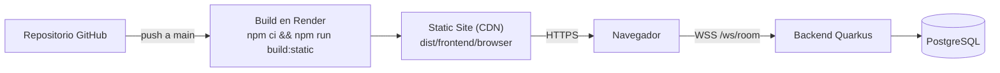

# Desplegar el frontend como Static Site en Render

Guía paso a paso para publicar el frontend de Angular en Render como sitio estático, con URLs profundas funcionando (F5 incluido) y la URL del backend inyectada en el build.

---

## Índice

- [Qué vas a conseguir](#qué-vas-a-conseguir)
- [Requisitos previos](#requisitos-previos)
- [Crear el Static Site](#crear-el-static-site)
- [Variables de entorno](#variables-de-entorno)
- [Rewrite para SPA (la parte crítica)](#rewrite-para-spa-la-parte-crítica)
- [Cómo se genera env.js](#cómo-se-genera-envjs)
- [Verificación](#verificación)
- [Problemas comunes](#problemas-comunes)
- [Actualizar variables de entorno](#actualizar-variables-de-entorno)
- [Opcional: render.yaml](#opcional-renderyaml)
- [Requisitos del backend](#requisitos-del-backend)

---

## Qué vas a conseguir



- Frontend servido desde el CDN de Render, sin contenedor ni servidor propio.
- HTTPS automático.
- `BACKEND_WS_URL` y `BACKEND_HTTP_URL` inyectadas en el build, sin tocar el bundle de Angular.
- Rutas de Angular (`/room/CODIGO`) resolviendo también al refrescar.

---

## Requisitos previos

| Requisito | Detalle |
|---|---|
| Repositorio | El proyecto subido a GitHub/GitLab/Bitbucket, con `frontend/package-lock.json` |
| Backend desplegado | Una URL accesible por `https`/`wss` (por ejemplo, un Web Service de Render) |
| Node del build | `22.22.0` recomendado (Angular 21 exige `^20.19`, `^22.12` o `>=24`) |
| Script de build | `build:static` ya existe en `frontend/package.json` |

Comprueba en local antes de desplegar:

```bash
cd frontend
BACKEND_WS_URL=wss://tu-backend/ws/room \
BACKEND_HTTP_URL=https://tu-backend \
npm run build:static
```

Debe generar `dist/frontend/browser/` y, dentro de `assets/`, un `env.js` con tus URLs.

---

## Crear el Static Site

1. En Render, pulsa **New + → Static Site**.
2. Conecta el repositorio.
3. Rellena la configuración:

   | Campo | Valor |
   |---|---|
   | **Name** | `true-fan-dice-roller` (o el que quieras) |
   | **Branch** | `main` |
   | **Root Directory** | `frontend` |
   | **Build Command** | `npm ci && npm run build:static` |
   | **Publish Directory** | `dist/frontend/browser` |
   | **Auto-Deploy** | `Yes` |

4. Pulsa **Create Static Site** y espera al primer build.

> **Importante:** `Root Directory` es `frontend`, así que el build command y el publish directory son relativos a esa carpeta. Si lo dejas en la raíz del repo, el build fallará.

---

## Variables de entorno

En el servicio: **Environment → Add Environment Variable**.

| Key | Value | Notas |
|---|---|---|
| `BACKEND_WS_URL` | `wss://tu-backend.onrender.com/ws/room` | Obligatoria. Debe ser `wss://` porque el sitio va por HTTPS. |
| `BACKEND_HTTP_URL` | `https://tu-backend.onrender.com` | Para el health check. Si se omite, se deriva del WS. |
| `NODE_VERSION` | `22.22.0` | Evita builds con una versión de Node incompatible. |
| `COREPACK_ENABLE_STRICT` | `0` | Solo si el build falla por `packageManager: npm@11.x`. |

> Las variables de un Static Site se leen **en tiempo de build**, no en runtime. Cambiarlas requiere un nuevo deploy.

---

## Rewrite para SPA (la parte crítica)

Angular usa rutas de cliente. Si alguien abre directamente `https://tu-app.onrender.com/room/ABC123` o pulsa **F5**, Render busca un archivo real en esa ruta y devuelve **Not Found**.

Solución: que todas las rutas que no sean archivos sirvan `index.html`.

1. Entra en el servicio → **Settings → Redirects/Rewrites**.
2. **Add Rule**:

   | Campo | Valor |
   |---|---|
   | **Source** | `/*` |
   | **Destination** | `/index.html` |
   | **Action** | **Rewrite** |

3. Guarda y vuelve a probar la URL profunda.

### Rewrite vs Redirect

- **Rewrite** (lo que necesitas): sirve `index.html` manteniendo la URL original. Angular lee `/room/ABC123` y pinta la sala.
- **Redirect**: cambia la URL a `/index.html` y perderías la ruta.

En Docker esto ya está resuelto en `frontend/nginx.conf`:

```nginx
location / {
    try_files $uri $uri/ /index.html;
}
```

### La sesión no se pierde

El token y el nick viven en `localStorage` (`diced-session`), que es por origen y sobrevive al 404. El problema es que sin el rewrite la aplicación nunca arranca. Con la regla aplicada, al cargar la sala se restaura la sesión y se envía `reconnect`. El token caduca a los 60 minutos; si ha expirado, habrá que volver a unirse.

---

## Cómo se genera env.js

El frontend no lleva las URLs del backend compiladas en el bundle. `src/index.html` carga `assets/env.js` antes de la app, y ese archivo se genera en el build:

1. `ng build --configuration production` genera `dist/frontend/browser/`.
2. `scripts/generate-env.mjs` escribe `dist/frontend/browser/assets/env.js` con `BACKEND_WS_URL` y `BACKEND_HTTP_URL`.
3. El navegador lee `window.__env.backendWsUrl` y `window.__env.backendHttpUrl`.

Por eso el build command es `npm ci && npm run build:static` y no `npm run build`.

Si `BACKEND_WS_URL` queda vacío, el frontend intenta autodetectarlo desde `window.location`, lo que solo funciona si sirves frontend y backend desde el mismo dominio.

---

## Verificación

Tras el deploy:

1. Abre la home: `https://tu-app.onrender.com`.
2. Comprueba la configuración inyectada:
   ```
   https://tu-app.onrender.com/assets/env.js
   ```
   Debe mostrar tus URLs reales, no `${BACKEND_WS_URL}` ni cadenas vacías.
3. Crea una sala y verifica que el indicador del backend pasa a **en línea**.
4. Copia la URL de la sala (`/room/CODIGO?nick=...`) y ábrela en una pestaña nueva: debe cargar.
5. Pulsa **F5** en la sala: debe seguir cargando y reconectar.
6. Recorre los temas y comprueba que se guardan al recargar.

---

## Problemas comunes

| Síntoma | Causa | Solución |
|---|---|---|
| **Not Found** al refrescar una ruta | Falta el rewrite de SPA | Añade `/* → /index.html` con acción **Rewrite** |
| El rewrite está pero sigue el 404 | Regla mal guardada o caché del navegador | Revisa que la acción sea **Rewrite** y prueba en incógnito |
| `assets/env.js` con `${BACKEND_WS_URL}` | Se usó `npm run build` en vez de `build:static` | Cambia el build command |
| `assets/env.js` con valores viejos | Las env vars se leen en build | Edita la variable y haz **Manual Deploy → Clear build cache & deploy** |
| El WebSocket no conecta | `ws://` en una página HTTPS (mixed content) | Usa `wss://` |
| El health check falla pero el WS funciona | `BACKEND_HTTP_URL` mal o backend sin CORS | Revisa la URL y `CORS_ORIGINS` del backend |
| Build falla en `npm ci` | `package-lock.json` desincronizado | Ejecuta `npm install` en `frontend/` y commitea el lock |
| Build falla por versión de Node | Node del builder demasiado antiguo | Define `NODE_VERSION=22.22.0` |
| Build falla por `npm@11.8.0` (corepack) | El campo `packageManager` fuerza una versión | Añade `COREPACK_ENABLE_STRICT=0` |
| El deploy tarda o falla sin motivo | Caché de build corrupta | **Manual Deploy → Clear build cache & deploy** |

---

## Actualizar variables de entorno

1. Cambia el valor en **Environment**.
2. Ve a **Manual Deploy → Clear build cache & deploy**.
3. Cuando termine, fuerza recarga en el navegador (`Ctrl+F5`).

No basta con guardar la variable: el `env.js` se genera durante el build.

---

## Opcional: render.yaml

Si quieres definir el sitio como código (Blueprint), añade `render.yaml` en la raíz del repositorio:

```yaml
services:
  - type: web
    name: true-fan-dice-roller
    runtime: static
    rootDir: frontend
    buildCommand: npm ci && npm run build:static
    staticPublishPath: ./dist/frontend/browser
    routes:
      - type: rewrite
        source: /*
        destination: /index.html
    envVars:
      - key: NODE_VERSION
        value: 22.22.0
      - key: BACKEND_WS_URL
        sync: false
      - key: BACKEND_HTTP_URL
        sync: false
      - key: COREPACK_ENABLE_STRICT
        value: "0"
```

`sync: false` hace que Render pida el valor en el primer deploy y no lo guarde en el repositorio.

Si el sitio ya existe creado desde el dashboard, el Blueprint sirve para recrearlo o para otros entornos; la regla de rewrite del dashboard es la que arregla el sitio actual.

---

## Requisitos del backend

Para que el frontend estático funcione, el backend debe cumplir:

- **HTTPS/WSS**: el sitio se sirve por HTTPS, así que el WebSocket debe ser `wss://`.
- **CORS**: por defecto el backend usa `CORS_ORIGINS=*`. Si lo restringes, incluye el dominio del Static Site.
- **Health check**: `GET /health/ready` debe responder `200` con `{"status":"UP"}`.
- **WebSocket**: ruta `/ws/room`.
- **Persistencia**: en producción, PostgreSQL configurado con `DB_URL`, `DB_USER` y `DB_PASSWORD`.

Ejemplo de variables del backend en Render:

```text
QUARKUS_PROFILE=prod
DB_URL=jdbc:postgresql://...
DB_USER=...
DB_PASSWORD=...
JWT_SECRET=...
CORS_ORIGINS=https://true-fan-dice-roller.onrender.com
```
